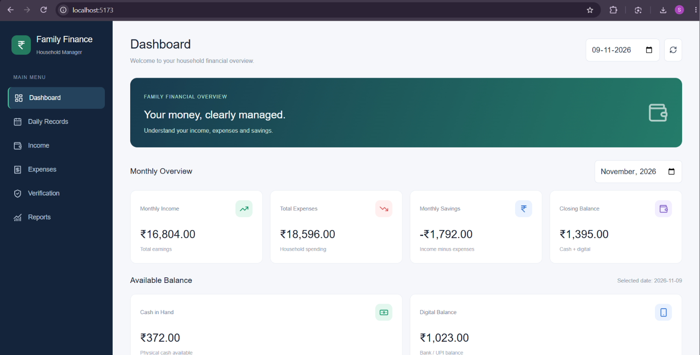
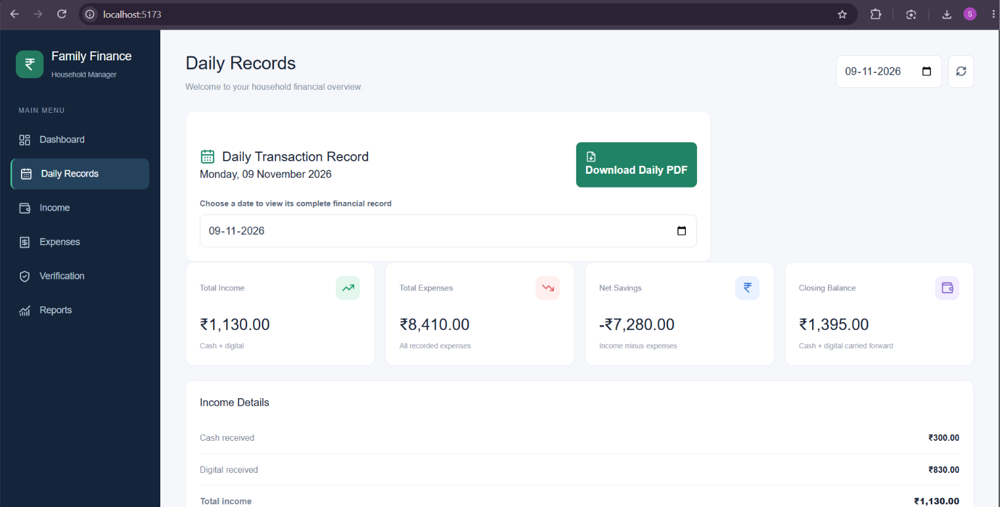
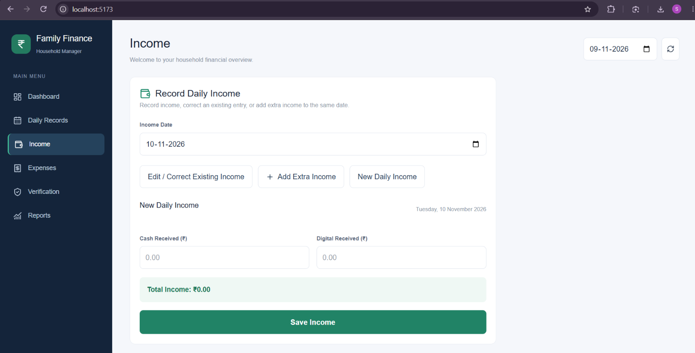
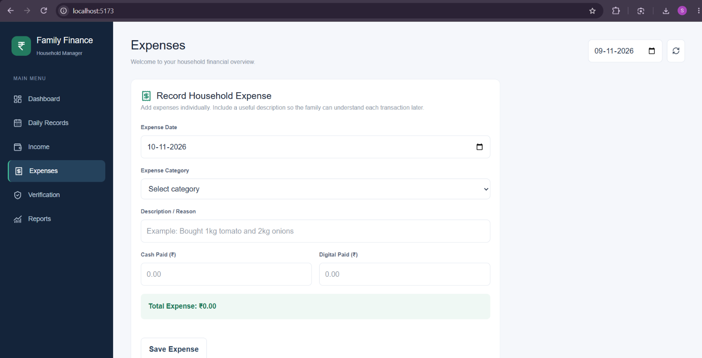
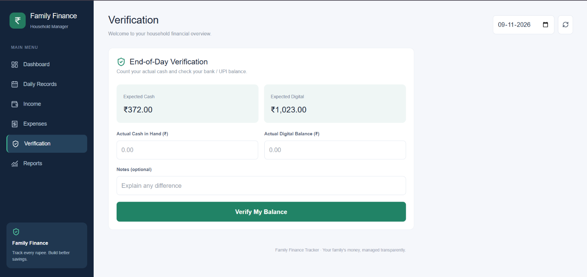

# 💰 Family Finance Tracker

A full-stack personal and family finance management application built with **React, FastAPI, Python, and SQLite**. Track daily income, expenses, cash and digital transactions, monitor balances, reconcile financial records, and generate daily PDF reports through an interactive dashboard.

---

## ⚙️ Installation and Setup

Follow these instructions to run the project locally.

### Prerequisites

Install the following:

- Python 3.10 or later
- Node.js and npm
- Git
- Visual Studio Code (recommended)

### Step 1: Clone the repository

```bash
git clone https://github.com/YOUR_USERNAME/family-finance-tracker.git
```

Navigate into the project:

```bash
cd family-finance-tracker
```

Replace `YOUR_USERNAME` with your GitHub username.

### Step 2: Set up the backend

Navigate to the backend folder:

```bash
cd backend
```

Create a Python virtual environment:

```bash
python -m venv venv
```

Activate the virtual environment on Windows PowerShell:

```powershell
.\venv\Scripts\Activate
```

Install the dependencies:

```bash
pip install -r requirements.txt
```

### Step 3: Start the FastAPI server

Run:

```bash
python -m uvicorn app.main:app --reload --port 8000
```

Backend server:

```text
http://127.0.0.1:8000
```

Interactive API documentation:

```text
http://127.0.0.1:8000/docs
```

### Step 4: Set up the frontend

Open a **second terminal** in the project root.

Navigate to the frontend folder:

```bash
cd frontend
```

Install Node.js dependencies:

```bash
npm install
```

### Step 5: Start the React development server

```bash
npm run dev
```

Frontend application:

```text
http://localhost:5173
```

Both backend and frontend servers must remain running while using the application.

---

---

## 📸 Application Screenshots

### 1. Dashboard
View monthly financial performance, income, expenses, savings, closing balances, and daily financial summaries.



### 2. Daily Records
View daily income, individual expenses, payment breakdowns, opening and closing balances, and net savings.



### 3. Income Management
Record daily income, correct existing income entries, add additional income, and monitor cash and digital payment amounts.



### 4. Expense Management
Record categorized expenses, track individual transactions, and edit incorrect entries, including cash and digital payment splits.



### 5. Balance Verification
Reconcile expected cash and digital balances against actual available balances and track differences.



---

## ✨ Features

### Dashboard
- Monthly income, expenses, and savings overview.
- Cash and digital balance monitoring.
- Daily financial summaries.
- Closing balance tracking.

### Income Management
- Record daily income.
- Track cash and digital income separately.
- Add additional income to an existing date.
- Edit and correct previously entered income.
- Automatically update financial balances.

### Expense Management
- Record individual expenses.
- Categorize expenses.
- Add expense descriptions.
- Track cash and digital payments separately.
- Edit existing expense transactions.
- Correct incorrect cash/digital payment entries.
- View saved transactions for the selected date.

### Daily Financial Records
- View daily income and expense details.
- Track opening and closing balances.
- Calculate net savings.
- View individual transaction breakdowns.
- Generate downloadable daily PDF reports.

### Balance Verification
- Compare expected balances with actual cash and digital balances.
- Identify cash and digital differences.
- Record reconciliation notes.

### Financial Calculations
- Automatic daily balance calculation.
- Cash and digital balance separation.
- Carry-forward balances between days.
- Recalculation of subsequent balances after transaction corrections.
- Monthly financial summaries.

---

## 🛠️ Tech Stack

| Layer | Technologies |
|---|---|
| Frontend | React, JavaScript, Vite |
| UI & Icons | CSS, Lucide React |
| API Integration | Axios |
| PDF Generation | jsPDF |
| Backend | Python, FastAPI |
| ORM | SQLAlchemy |
| Validation | Pydantic |
| Database | SQLite |
| API Server | Uvicorn |
| Version Control | Git and GitHub |

---

## 🏗️ Project Architecture

```text
family-finance-tracker/
│
├── backend/
│   ├── app/
│   │   ├── __init__.py
│   │   ├── main.py
│   │   ├── database.py
│   │   ├── models.py
│   │   ├── schemas.py
│   │   │
│   │   └── routers/
│   │       ├── __init__.py
│   │       └── finance.py
│   │
│   ├── data/
│   ├── requirements.txt
│   └── requirements-dev.txt
│
├── frontend/
│   ├── src/
│   │   ├── services/
│   │   │   └── api.js
│   │   ├── App.jsx
│   │   ├── index.css
│   │   └── main.jsx
│   │
│   ├── public/
│   ├── package.json
│   ├── package-lock.json
│   └── index.html
│
├── docs/
│   └── images/
│       ├── dashboard.png
│       ├── daily-records.png
│       ├── income.png
│       ├── expenses.png
│       └── verification.png
│
├── .gitignore
└── README.md
```

## 🔌 API Endpoints

The backend exposes REST APIs under:

```text
/api/finance
```

| Method | Endpoint | Purpose |
|---|---|---|
| GET | `/categories` | Retrieve expense categories |
| POST | `/income` | Create daily income |
| PUT | `/income/{target_date}` | Correct existing income |
| POST | `/income/additional` | Add additional income |
| POST | `/expenses` | Create an expense |
| PUT | `/expenses/{expense_id}` | Edit an expense |
| GET | `/daily/{target_date}` | Retrieve daily summary |
| GET | `/daily-details/{target_date}` | Retrieve daily transaction details |
| GET | `/monthly/{year}/{month}` | Retrieve monthly summary |
| POST | `/reconcile` | Reconcile actual and expected balances |

Interactive API testing is available through FastAPI Swagger UI at `/docs`.

---

## 🗄️ Database and Data Persistence

The application uses **SQLite** for local financial data storage.

Database location:

```text
backend/data/family_finance.db
```

The database stores:

- Daily income records.
- Expense transactions.
- Expense categories.
- Daily cash and digital balances.
- Financial reconciliation records.

SQLite allows the application to run locally without requiring a separate database server.

**Important:** The database is intentionally excluded from Git using `.gitignore`. Your financial records remain in your local database and are not automatically uploaded to GitHub.

Back up your database periodically.

---

## 🔄 Balance Calculation

The application maintains separate cash and digital balances.

The general calculation is:

```text
Closing Balance = Opening Balance + Income - Expenses
```

The calculation is performed separately for cash and digital transactions.

Daily closing balances are carried forward as the next day's opening balances.

When an existing income or expense is corrected, the application recalculates the affected daily balances and subsequent balances.

---

## 🧪 Running the Application

Once both servers are running:

1. Open the frontend in your browser.
2. Record daily income.
3. Add categorized expenses.
4. Correct any incorrect transactions when necessary.
5. Review daily and monthly summaries.
6. Verify actual cash and digital balances.
7. Generate daily PDF reports.

---

## 🚀 Future Improvements

Potential enhancements include:

- User authentication and secure access.
- Cloud database integration.
- Multi-user family accounts.
- Automated recurring expense entries.
- Interactive financial analytics.
- Monthly and yearly PDF reports.
- Automated database backups.
- Mobile-friendly enhancements.

---

## 👨‍💻 Author

**Prabath Damarla**

B.Tech – Computer Science and Engineering (AI & ML)

GitHub: [prabath1703](https://github.com/prabath1703)

---

## 📄 License

This project is licensed under the MIT License.

---

⭐ If you find this project useful, consider giving the repository a star!